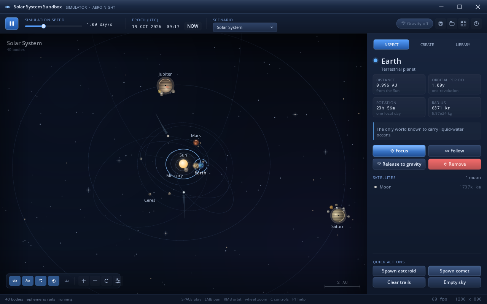
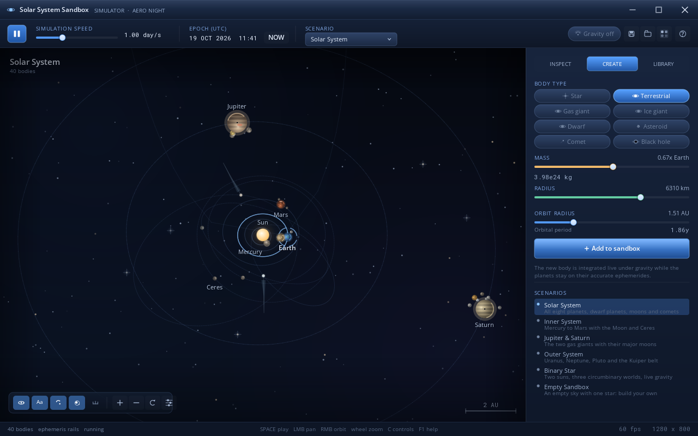
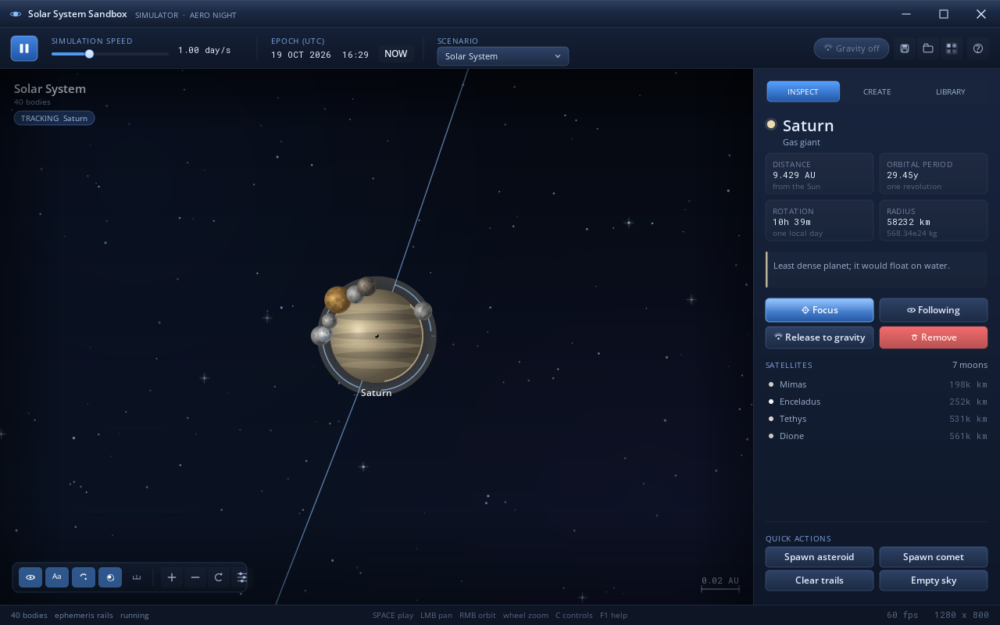
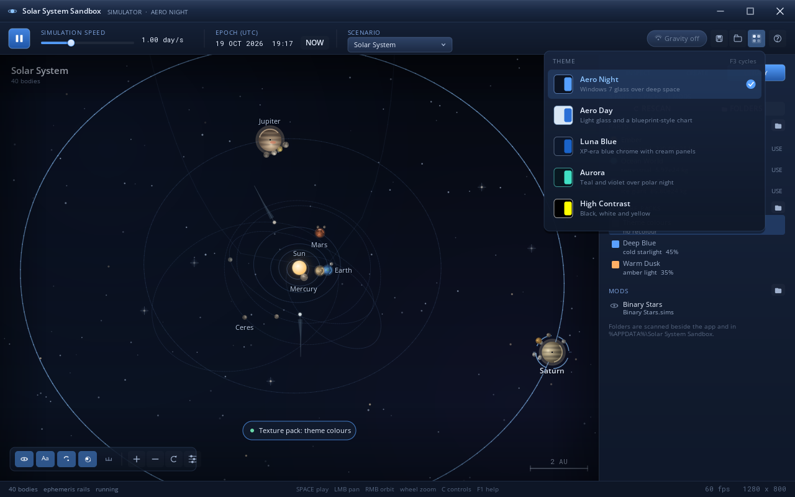
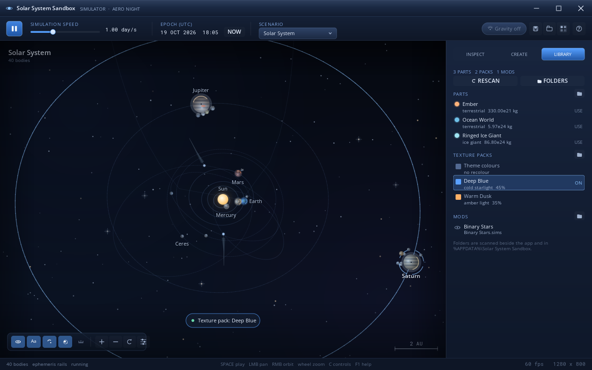
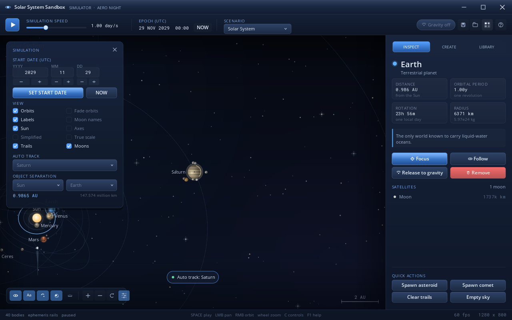
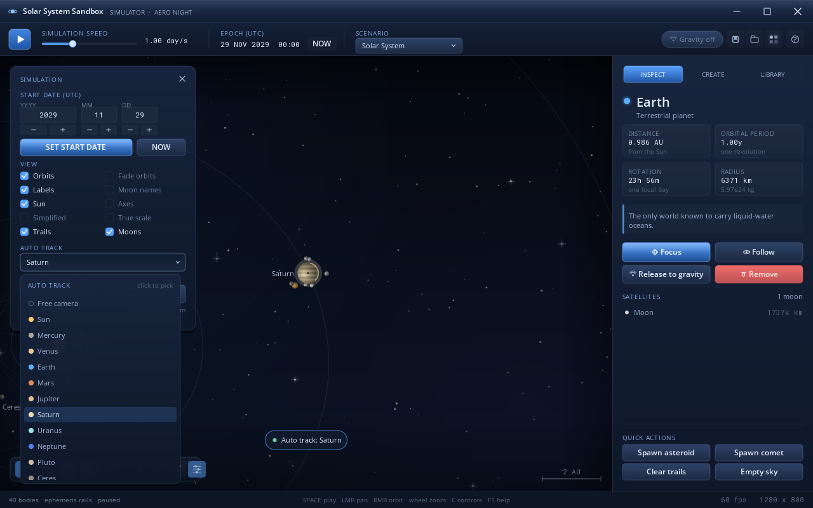

# Solar System Sandbox

**[Download the installer](https://github.com/testID001772/solar-system-sandbox-simulator/raw/HEAD/dist/SolarSystemSandbox-1.0.0-Setup.exe)** ·
**[Project site](https://testid001772.github.io/solar-system-sandbox-simulator/)** ·
**[Screenshots](docs/screenshots/)**

A real-time solar system simulator and gravity sandbox for **Windows 7 SP1 and later**,
dressed in a Windows 7 Aero-inspired interface: a glass-blue title bar, glowing chrome,
Segoe UI typography and softly shaded planets.

Planets follow JPL's approximate ephemerides, but the moment you add, remove or release a
body the simulation switches to a symplectic N-body integrator and everything starts
pulling on everything else.



| Selection & hover readout | Create a body |
| --- | --- |
|  |  |



### Themes

Five palettes for the shell **and** the viewport, switched at runtime with the palette
button in the transport bar, the *View → Colour theme* menu, <kbd>F3</kbd>, or the theme
row on the installer's welcome page. The picker previews each palette with a swatch and a
one-line description; the choice is remembered in
`%APPDATA%\Solar System Sandbox\settings.ini` and saved inside `*.sims` files.



| Theme | Look |
| --- | --- |
| **Aero Night** | the original Windows 7 glass over deep space |
| **Aero Day** | light glass, blueprint-style chart; planets keep true colours |
| **Luna Blue** | XP-era blue chrome, cream panels, night-sky viewport |
| **Aurora** | teal and violet over polar night |
| **High Contrast** | black, white and yellow, no vignette or nebula wash |

Every colour lives in one table (`src/theme.c`), so a new theme is a single entry: the
shell, buttons, cards, sliders, overlays, starfield, orbit lines, labels and the setup
wizard all read from it.

### Content folders

Six folders make the app moddable without a compiler. They are created next to the
executable **and** in `%APPDATA%\Solar System Sandbox`; the *Library* tab (or
<kbd>F4</kbd>) lists everything found in both and prefers the writable per-user copy.



| Folder | What goes in it |
| --- | --- |
| `Assets/` | images, icons and fonts kept with a mod or a screenshot |
| `Parts/` | `.part` body templates — click one to load it into the composer |
| `Texture Pack/<name>/` | a `pack.ini` recolour pack: `tint` plus a `strength` of 0–100 |
| `Mods/Custom_/` | extra `.sims` scenarios, listed under Mods and loaded with one click |
| `Logs/` | `app.log`, a timestamped record of startup, scans, saves and loaded mods |
| `Saving/` | where *Save simulation* starts; copy saves to `Mods/Custom_` to share them |

Parts and texture packs are plain text:

```ini
# Parts/Ocean World.part
name   = Ocean World
kind   = terrestrial          # star terrestrial giant ice dwarf asteroid comet blackhole
mass   = 5.97e24              # kg
radius = 6371                 # km
orbit  = 1.0                  # AU
ecc    = 0.02
color1 = #6ec0e8              # lit colour; color2 is the shaded side
accent = #8fd8ff
note   = Temperate ocean world with a breathable sky.
```

```ini
# Texture Pack/Warm Dusk/pack.ini
name     = Warm Dusk
note     = amber light
tint     = #ffb066
strength = 35                 # 0-100, how far body colours move to the tint
```

The installer ships three parts (Ocean World, Ember, Ringed Ice Giant), two texture packs
(Warm Dusk, Deep Blue) and a binary-star scenario; every folder also carries a README with
the full key list. A part keeps its own colours, rings and name; picking a body-type chip
in the create panel returns to that type's palette. A texture pack tints the lit side of
every planet, moon and small body — stars keep their glow — and is cleared with
*Theme colours*.

### Simulation controls

<kbd>C</kbd>, or the sliders button at the end of the view pill, opens a controls panel
with the jobs a classic gravitator puts on its toolbar:

- **Start date** — spin the year, month and day fields and press **Set start date** to
  move the ephemerides to 00:00 UTC on that day; entry is clamped to 1800–2100, leap
  years included (the JPL fit is sharpest over 1800–2050). **NOW** jumps back to the
  present. The transport bar's `EPOCH (UTC)` readout follows immediately.
- **View switches** — Orbits, *Fade orbits* (the half of each path behind its planet
  dims), Labels, *Moon names*, *Sun*, *Axes* (world X/Y rulers with 1/2/5 ticks),
  *Simplified* (flat shaded discs without terminator detail), True scale, Trails and
  Moons.
- **Auto track** — choose any body from the popup list and the camera glides after it, or
  pick *Free camera*. The *Follow* button in the inspector drives the same state.
- **Object separation** — pick objects A and B and read their live distance in AU and
  kilometres; the readout updates every frame while the clock runs.
- On short windows the panel scrolls with the mouse wheel (a slim scrollbar shows the
  position), so every section stays reachable on a 1024×600 netbook screen.

| Simulation panel | Auto-track picker |
| --- | --- |
|  |  |

## Highlights

- **Accurate starting point** — 40 bodies (Sun, eight planets, Pluto and Ceres, the major
  moons, comets and the asteroid belt) positioned from JPL's approximate ephemerides,
  valid 1800–2050. The clock starts at today's date.
- **Gravity sandbox** — add stars, planets, moons, comets or a black hole from the
  *Create body* tab; choose mass, radius and orbit; drop it into the scene. Toggle N-body
  gravity with <kbd>N</kbd>, release a planet from its rail with one click, delete with
  <kbd>Delete</kbd>. Collisions merge bodies and are reported in the event feed.
- **Time controls** — pause with <kbd>Space</kbd>, pick 1 hour/s, 1 day/s, 1 week/s,
  1 month/s or 1 year/s with <kbd>1</kbd>–<kbd>5</kbd>, drag the speed slider, or set any
  start date from 1800 to 2100 in the simulation panel (<kbd>C</kbd>).
- **Camera** — drag to pan, right-drag to orbit, wheel to zoom toward the cursor,
  <kbd>F</kbd> to focus the selected body, *Auto track* to keep any body centred,
  <kbd>R</kbd> to reset. A scale bar always tells you what you are looking at.
- **Windows 7 look** — the entire interface is drawn by the app: Aero-style gradient
  chrome, glossy controls, Segoe UI and Consolas text, and vector planet shading with
  glow, rings and terminators. The screenshot harness below renders through a software
  rasteriser, so the same pixels are testable on any OS.
- **Runtime themes** — five palettes (Aero Night, Aero Day, Luna Blue, Aurora, High
  Contrast) recolour the shell, the scene and the installer, previewed in a dropdown and
  remembered between sessions.
- **Drop-in content** — *Library* tab for parts, texture packs and mods; six folders next
  to the app and in `%APPDATA%`; the installer seeds them with samples and each one has a
  README.
- **Scenarios** — Solar System, Inner System, Jupiter & Saturn, Outer System, Binary Star
  and an Empty Sandbox for building a system from scratch.
- **Files** — save and load simulations as `*.sims` text files (the active theme travels
  with the save); <kbd>F12</kbd> writes a BMP screenshot next to the executable.
- **No runtime to install** — the app is a 320 KB executable that links no C runtime at
  all and uses only DLLs that ship with Windows 7 (GDI+, user32, shell32, comdlg32, gdi32,
  kernel32).
- **Low-end friendly** — one 32-bit process, one thread, no GPU and no .NET. On a
  single-core CPU or under 1.5 GB of RAM it automatically switches to a lighter render
  path (fewer stars, no nebula wash, 30 fps timer). The app state is about 3 MB and the
  1280×800 back buffer 4 MB; the software-renderer harness peaks around 10 MB.

## Install

Run **`dist/SolarSystemSandbox-1.0.0-Setup.exe`** and follow the wizard. The installer is
a single 2.2 MB executable that contains the application, the licence, this readme,
the screenshots and the sample content folders.

- lets you pick a colour theme before installing (the app opens with the same one),
- asks for administrator rights and installs to `C:\Program Files\Solar System Sandbox`
  (or `Program Files (x86)` on 64-bit Windows),
- adds *Solar System Sandbox* to the Start menu, optionally to the desktop,
- creates `Assets`, `Parts`, `Texture Pack`, `Mods\Custom_`, `Logs` and `Saving` in the
  install folder and in `%APPDATA%\Solar System Sandbox`, with sample parts, packs and a
  scenario,
- registers a normal *Programs and Features* entry with an uninstaller,
- offers to launch the app when it finishes.

Uninstall from **Control Panel → Programs and Features**, from the Start menu shortcut,
or by running `Uninstall.exe /uninstall` in the install folder.

### If the window does not appear

The app writes a startup trace to `%TEMP%\SolarSandbox-startup.log`, one line
per stage (GDI+, theme, window creation, first frame, content scan). *Help → Open startup
log* opens it. Holding **Shift** while launching, or passing `--safe`, skips the saved
theme and the content scan — useful when a folder or a settings file is making startup
slow. The last line in the trace names the stage that stalled.

Prefer a portable copy? `build/SolarSandbox.exe` runs from any folder — no installer and
no registry entry. It still keeps `settings.ini`, `Logs` and `Saving` in
`%APPDATA%\Solar System Sandbox` so they stay writable, and it reads content from both
its own folder and that per-user folder.

**Requirements:** Windows 7 SP1 or later, 32-bit or 64-bit, 1280×800 or larger is
recommended. A 1 GB RAM, single-core machine is supported: the app detects it at startup
and uses the lighter render path with a 30 fps timer. There is nothing else to install:
GDI+ has shipped with Windows since XP.

## Controls

| Input | Action |
| --- | --- |
| <kbd>Space</kbd> | play / pause |
| <kbd>1</kbd> … <kbd>5</kbd> | speed presets (hour, day, week, month, year per second) |
| <kbd>N</kbd> | toggle N-body gravity |
| <kbd>O</kbd> / <kbd>L</kbd> / <kbd>T</kbd> / <kbd>M</kbd> | orbits / labels / trails / moons |
| <kbd>F</kbd> | focus the selected body |
| <kbd>F3</kbd> | cycle the colour theme |
| <kbd>F4</kbd> | open the content library |
| <kbd>C</kbd> | simulation controls: start date, view switches, track, separation |
| <kbd>R</kbd> | reset the view |
| <kbd>Delete</kbd> | remove the selected body |
| <kbd>Esc</kbd> | close popups and the controls panel, then clear the selection |
| <kbd>F1</kbd> | help overlay |
| <kbd>F5</kbd> / <kbd>Ctrl</kbd>+<kbd>S</kbd> | save a simulation |
| <kbd>F9</kbd> / <kbd>Ctrl</kbd>+<kbd>O</kbd> | open a simulation |
| <kbd>F12</kbd> | save a BMP screenshot |
| Drag | pan |
| Right-drag | orbit / tilt the camera |
| Wheel | zoom toward the cursor |

## Building

The Windows binaries are cross-compiled from any OS with Zig's C compiler — no Visual
Studio, MinGW or Windows SDK is needed.

```bash
python3 -m venv .venv
. .venv/bin/activate
pip install ziglang          # 0.17 or newer

tools/build_windows.sh all   # or: app, installer, clean
```

Outputs:

| File | Size | What it is |
| --- | --- | --- |
| `build/SolarSandbox.exe` | 320 KB | portable application |
| `dist/SolarSystemSandbox-1.0.0-Setup.exe` | 2.2 MB | installer (application + docs + samples + icon) |

`tools/build_windows.sh` compiles each translation unit for `x86-windows-gnu`, links
with `-nostdlib` and a custom entry point, then runs `tools/pe_patch.py` to inject the
icon, manifest and version resource into a fresh `.rsrc` section (LLD cannot link a
`.res`). The installer build packs `build/payload/` with `tools/make_payload.py`, embeds
the blob as a COFF data section with `tools/make_coff_payload.py`, and links the setup
program against it. Content samples from `content/` are copied into the payload and
extracted with their sub folders, so a fresh install already has parts, packs and a mod.

The build also copies the sample content folders next to `build/SolarSandbox.exe`, so a
portable run sees the same Parts, Texture Pack and Mods as an installed copy.

The application deliberately avoids the C runtime: `src/crt_min.c` provides the handful
of memory, string and math routines that remain, binding `msvcrt`'s maths only when a
function is first used. That keeps the import table at six system DLLs and makes the
same `.exe` work on a stock Windows 7 SP1 install with no redistributables.

## Repository layout

```
src/            application sources (C99)
  core.[ch]       allocators, strings, UTF-8, date maths
  sim.[ch]        bodies, ephemerides, N-body, collisions, save/load
  scene.c         viewport renderer: starfield, orbits, planets, labels
  content.[ch]    content folders: parts, texture packs, mods, log
  ui.c            chrome, inspector, create panel, library, theme picker, input
  theme.[ch]      the palette table (five themes) and the active selection
  app.[ch]        application state, camera, presets
  gfx_gdi.c       GDI+ drawing backend (the Windows app)
  gfx_soft.c      software rasteriser (screenshot tests)
  crt_min.c       minimal runtime for the CRT-free link
  main_win32.c    Win32 shell: window, menus, dialogs, timer
src/installer/  setup program (payload parser, install logic, wizard UI)
content/        sample Assets, Parts, Texture Pack, Mods, Logs and Saving folders
tools/          build scripts, PE resource injector, payload packer, font/icon baking
tests/          engine tests, payload tests, headless screenshot harness
assets/         application icon
docs/           screenshots and icon for the readme
```

## Tests

```bash
# simulation engine (22 checks: ephemerides, Kepler, N-body, save/load, collisions)
gcc -std=c99 -O2 -Wall -Wextra -Wno-unused-parameter -Isrc \
    tests/test_sim.c src/sim.c src/core.c -lm -o /tmp/test_sim && /tmp/test_sim

# installer payload parser, CRC and byte-for-byte extraction
gcc -std=c99 -O1 -Wall -Wextra -Isrc \
    tests/test_payload.c src/installer/payload.c src/core.c -lm -o /tmp/test_payload
/tmp/test_payload build/payload.bin build/payload   # after tools/build_windows.sh

# content folders: colour parsing, .part/.ini scanning, rescan, logging
gcc -std=c99 -O1 -Wall -Wextra -Isrc \
    tests/test_content.c src/content.c src/core.c -o /tmp/test_content && /tmp/test_content

# simulation panel: start-date clamping, view switches, picker clicks, separation,
# short-window scrolling and the low-power scene path
gcc -std=c99 -O1 -Wall -Wextra -Wno-unused-parameter -Isrc \
    tests/test_ui.c src/ui.c src/scene.c src/app.c src/sim.c src/content.c src/theme.c \
    src/core.c src/gfx_soft.c -lm -o /tmp/test_ui && /tmp/test_ui

# headless UI screenshots (writes /tmp/shot_*.ppm through gfx_soft.c,
# including the library tab, the simulation panel, the theme picker and one
# frame per theme)
gcc -std=c99 -O1 -Isrc tests/render_ui.c src/ui.c src/scene.c src/app.c src/sim.c \
    src/content.c src/theme.c src/core.c src/gfx_soft.c -lm -o /tmp/render_ui && /tmp/render_ui
```

## How it works

- **Ephemerides** — `sim_load_preset()` places each planet from JPL's approximate
  elements (mean longitude, semi-major axis, eccentricity, inclination, node and
  perihelion) and the app advances the clock in real time. When any body goes dynamic
  the state is frozen into world positions and kicked through a velocity-Verlet
  integrator with adaptive sub-steps.
- **Rendering** — `scene.c` projects with a simple tilted orthographic camera, draws
  orbit trails, shaded planet discs (radial gradients with a terminator), rings, glow,
  a starfield, then lays labels out with a greedy solver that avoids other labels and
  body discs. Colours come from `sss_theme()`, so switching palettes re-skins both the
  chrome in `ui.c` and the viewport without restarting.
- **Content** — `src/content.c` scans `Parts`, `Texture Pack` and `Mods` two levels deep
  in both roots, parses `key=value` files with a tolerant reader (unknown keys are
  ignored), and appends to `Logs/app.log`. Texture packs only move a body colour towards
  the tint (by `strength`), so the ephemeris colours and the active theme still show
  through; stars and black holes are left alone.
- **Themes** — `src/theme.c` holds one `SsTheme` struct per palette (around 90 colours
  each plus starfield alpha and vignette strength). The installer links the same file and
  reads the same `settings.ini`, so setup and the app always agree on the look.
- **Installer** — the setup executable carries the payload as a read-only data section
  (`SSSPAY1` format: length-prefixed entries with CRC-32). It creates nested folders
  (creating parents first) for the sample content and seeds the same six folders in
  `%APPDATA%`, then writes the files, copies
  itself in as `Uninstall.exe`, creates shell links through `IShellLink`, registers the
  uninstall entry and schedules its own deletion when removed.

## Licence

MIT — see [LICENSE](LICENSE). The bundled `tools/fonts/*.woff2` files are used only by the
headless screenshot harness: Open Sans (Apache-2.0) and Roboto Mono (SIL OFL-1.1).
